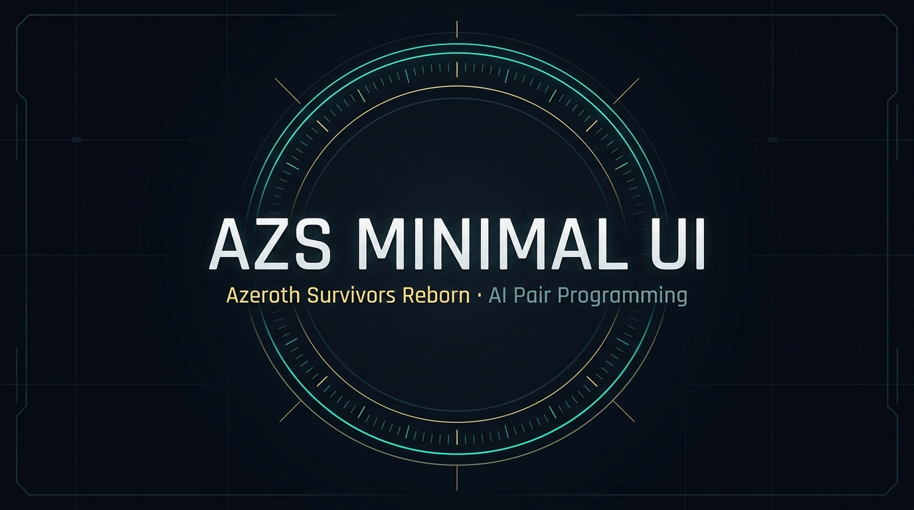
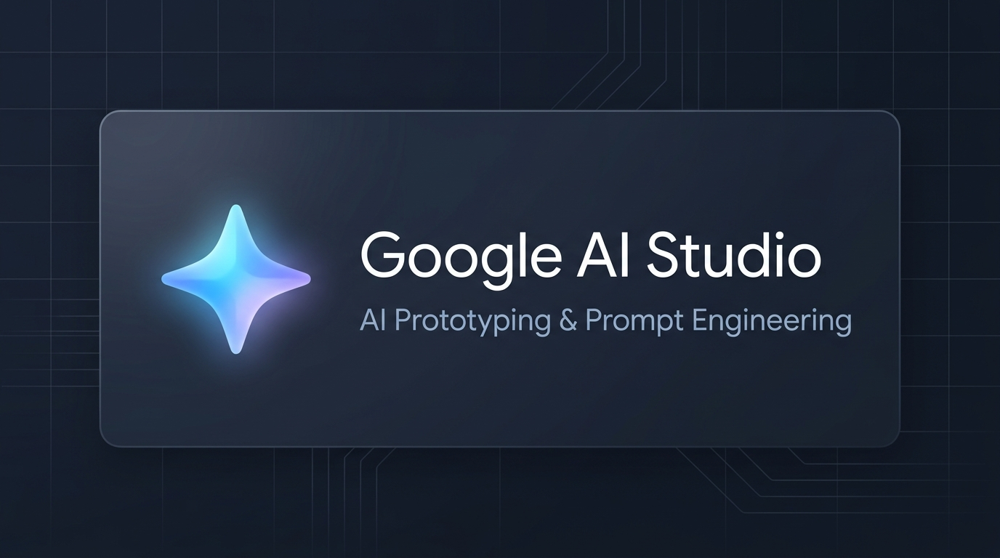
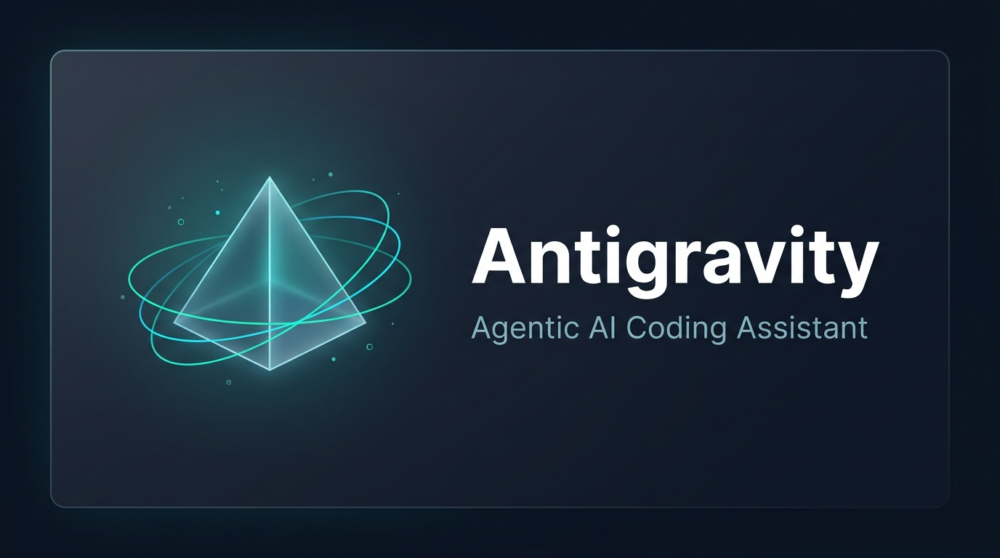
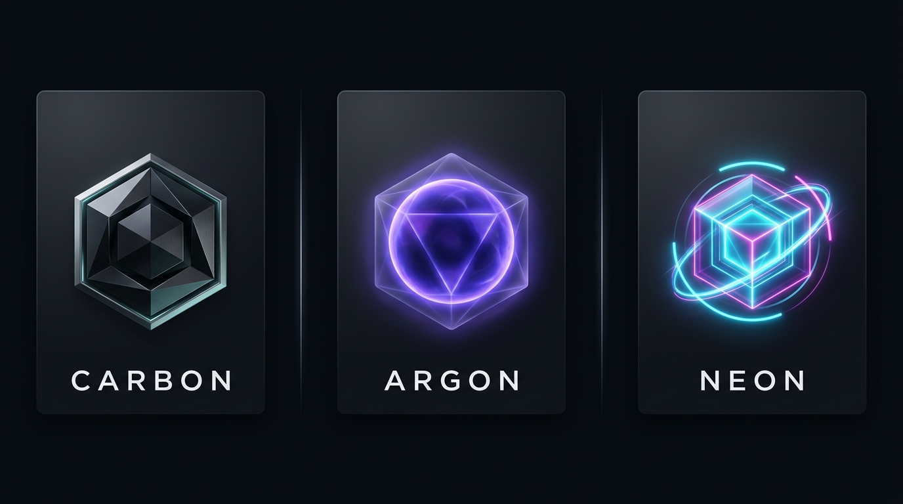

<p align="center">
  
</p>

<p align="center">
  
  
  
  
</p>

<h3 align="center">
  Ultra-minimalist modular UI addon for <strong>Azeroth Survivors Reborn</strong> — built as a hands-on <strong>AI Pair Programming</strong> learning project.
</h3>

---

## About This Project

**AZS Minimal UI** was created with the goal of learning and exploring **Pair Programming with Artificial Intelligence** in a real-world software project — from architecture design, Lua 5.1 optimization, and WoW 3.3.5a API integration to visual UI engineering, QA testing, and security auditing.

Every module, layout system, buff tracker, and performance optimization in this repository was iteratively designed, refactored, and refined through human + AI collaboration using **Google AI Studio** and **Antigravity**, powered by the **Carbon**, **Argon**, and **Neon** models.

---

## AI Tools & Models Used

### Development Tools

<table>
  <tr>
    <td align="center" width="50%">
      <br />
      <strong>Google AI Studio</strong><br />
      <sub>Used for ideation, prompt iteration, API exploration, and rapid prototyping.</sub>
    </td>
    <td align="center" width="50%">
      <br />
      <strong>Antigravity</strong><br />
      <sub>Used for agentic pair programming, multi-file refactoring, live debugging, and automated QA/security verification.</sub>
    </td>
  </tr>
</table>

### AI Models

<p align="center">
  
</p>

| Model | Role in Pair Programming |
| :--- | :--- |
| **Carbon** | Core architecture design, complex Lua 5.1 refactoring, and deep API reverse-engineering |
| **Argon** | Feature implementation, buff/cooldown tracking logic, UI layout engineering, and translation |
| **Neon** | Fast iterations, micro-optimizations, syntax validation, and QA/security sweeps |

---

## Key Features

- **90% Free Screen Layout** — Clean, dark minimal aesthetic that replaces cluttered native panels while keeping every module individually toggleable (`Minimal` / `Original` / `Both OFF`).
- **Visual Drag & Scale Editor (`/minui`)** — Unlock all panels, snap to an 8px alignment grid, resize with the corner grip or mouse wheel, fine-tune with a D-pad, and customize fonts & opacity live.
- **Enhanced Player & Party Buffs** — Tracks active buffs with resolved server/combat-log durations (including damage & invincibility skills), equipped jewelry buffs (rings, trinkets, amulets) for both player and party allies, pre-match talents & racials, and debuffs/hexes.
- **Buff Cooldowns Window** — Dedicated real-time tracker showing **ACTIVE**, **Recharging**, and **READY** status for item, skill, talent, and racial buffs.
- **Stats & Caps Panel** — Live survivability score, CDR/Crit/Damage Reduction/Echo cap tracking, and live **Account Gold** earned in the run (`AZS_RUN.gt`) with gold/min breakdown on hover.
- **360° Camera-Aligned Compass & 3D World Pins** — Off-screen/on-screen radar for chests, lairs, portals, totems, bosses, and downed allies.
- **3D Skill Attack Ranges** — Ground range rings with edge icons scaled to your Area stat.
- **Custom Enemy Nameplates & Side Damage Feed** — Rarity-colored bars (Elite, Guardian, Boss) and separate Normal/Crit damage feeds.
- **Party Health, Party DPS & Loot Panel** — Real-time group tracking and filterable drop history.
- **Tactical Engine (Beta)** — Run pace monitor, 5-second survivability simulation, stat priority advisor, and live coach alerts.

---

## Installation

1. Download or clone this repository into your Azeroth Survivors Reborn `AddOns` folder:
   ```text
   <Game Folder>\Interface\AddOns\AZS_MinimalUI\
   ```
2. Make sure the folder is named **`AZS_MinimalUI`** and contains `AZS_MinimalUI.toc` directly inside it.
3. Launch the game (or run `/reload` if already logged in) and enable **AZS Minimal UI** in the AddOns list.

---

## Slash Commands

| Command | Description |
| :--- | :--- |
| `/minui` or `/azsui` | Open / close the visual configuration editor |
| `/minui unlock` or `/minui move` | Unlock all HUD panels for dragging and scaling |
| `/minui lock` | Lock panels and save positions |
| `/minui sync` | Request a live state sync from the server |
| `/minui suppress` or `/minui clean` | Reapply native/Blizzard UI suppression |

---

## Project Structure

```text
AZS_MinimalUI/
├── AZS_MinimalUI.toc          # Addon manifest & load order
├── AZS_Suppress.lua           # Native & Blizzard frame suppression bridge
├── Init.lua                   # Main driver loop, events & slash commands
├── Core/
│   ├── Config.lua             # Defaults, module definitions & box layout presets
│   ├── Utils.lua              # Shared formatting, UI helpers & SavedVariables safety
│   ├── BuffTracker.lua        # Unified aura, item, talent, race & cooldown engine
│   ├── Database.lua           # SavedVariables initialization & layout migrations
│   └── Movable.lua            # Drag, scale, snap-to-grid & overlay system
├── Modules/                   # Modular HUD panels, buffs, compass, nameplates & editor
├── ModulesBeta/               # Run pace, tactical simulator & live coach
└── Assets/                    # Minimalist TGA textures
```

---

<p align="center">
  <sub>Crafted through <strong>AI Pair Programming</strong> with <strong>Google AI Studio</strong> & <strong>Antigravity</strong> · Models: <strong>Carbon</strong> · <strong>Argon</strong> · <strong>Neon</strong></sub>
</p>
